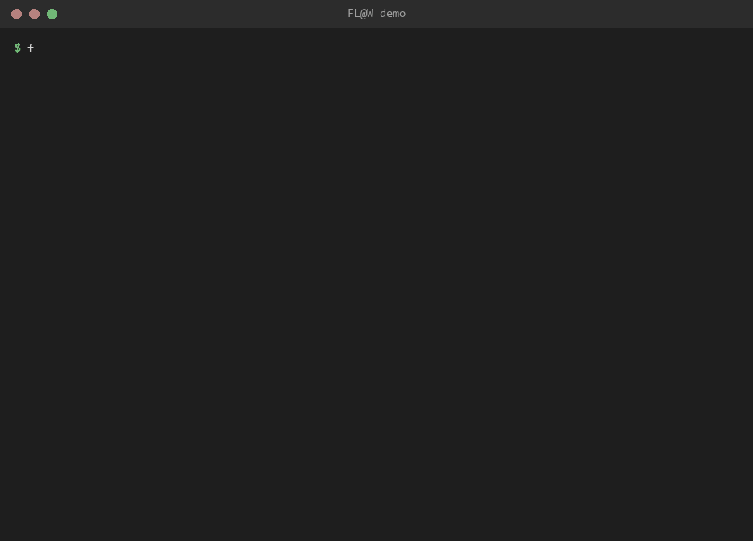
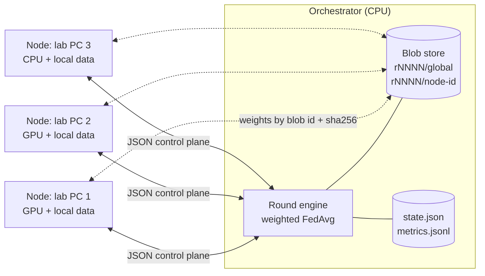
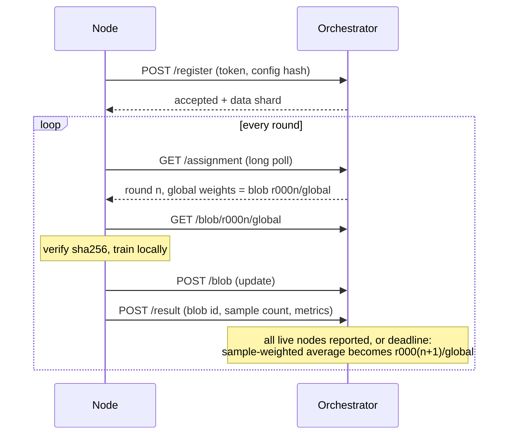
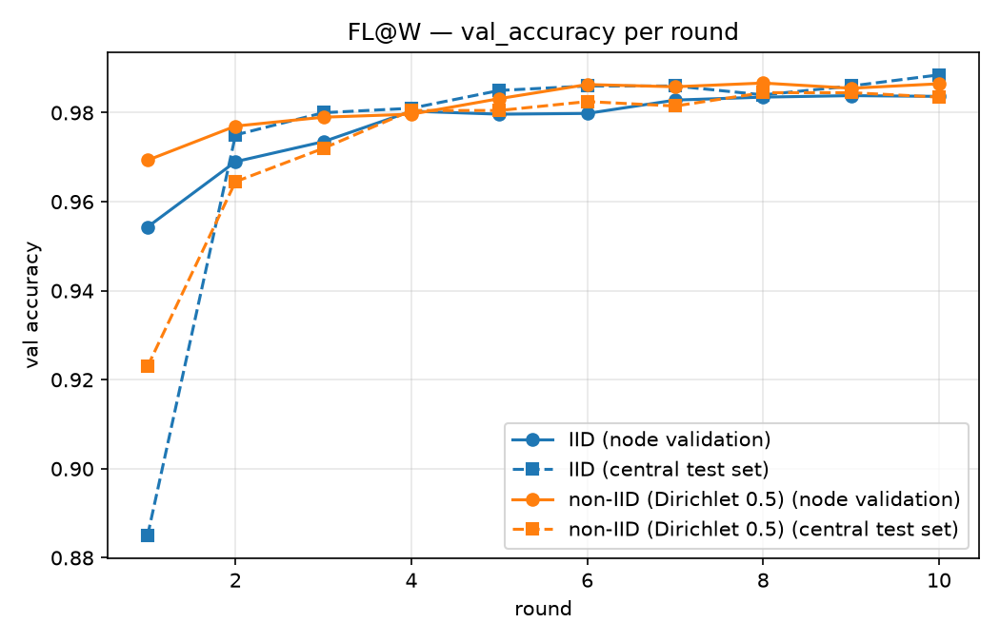

# FL@W — Federated Learning at Work

Train one model across the PCs you already have. Each machine trains on its own data,
an orchestrator averages everyone's weights every round, and no raw data ever leaves
its machine. Federated averaging (FedAvg) written from scratch over HTTP plus a small
blob store, sized for 1–3 lab PCs with consumer GPUs, and it still runs on a laptop CPU.



## Why this exists

University labs often have a handful of decent but unremarkable PCs, each with its own
data that can't easily be pooled: it's too big to copy around, it belongs to different
groups, or it simply shouldn't leave the machine it was recorded on. Federated learning
fits that situation exactly, but the established frameworks are built for large
deployments and take real effort to learn and operate.

FL@W is the opposite trade-off: **one YAML file and two commands**. Start the
orchestrator on one PC, start a node on each of the others, and they train a single
PyTorch model together. Nodes may join late, leave early or crash; the run carries on.

## How it works



Small JSON messages coordinate the run; the heavy weight files travel separately as
blobs addressed by id and verified by sha256 before they are loaded. One round:



- **Soft-synchronous rounds.** A round closes as soon as every node that was alive at
  its start has reported, or at `round_deadline_s`. Late nodes simply join the next round.
- **Void, never skip.** If fewer than `min_participants` usable results arrive, the round
  is re-run under the same number.
- **Crash-safe.** The orchestrator recovers its round from the blob store after a
  restart, and nodes re-register automatically and keep their data shard.

## Quick start

```bash
git clone https://github.com/ngwes/FLOW.git
cd FLOW
pip install -e ".[plot]"

flaw simulate examples/tiny-sim/flaw.yaml --nodes 2
```

`simulate` starts a real orchestrator plus N nodes on this machine, using a tiny
built-in dataset: no GPU and no download. Artifacts land in `runs/tiny-sim/`.

## Results

All numbers below come from `flaw simulate`: a real orchestrator and real nodes talking
HTTP, run on a single CPU-only machine (no GPU) inside Docker.

**MNIST, two nodes.** This uses `examples/mnist/flaw.yaml`, the same file two lab PCs
would use:

| round | validation accuracy | round time |
|---|---|---|
| 1 | 96.87% | 21.3 s |
| 2 | 97.58% | 22.0 s |
| 3 | **98.32%** | 22.4 s |

The run stops after round 3, when early stopping reaches its 98% target: 73 s of wall
clock including startup. Validation accuracy is the sample-weighted mean over each
node's held-out 10% split.

**IID vs non-IID data.** Real labs rarely hold evenly mixed data. This experiment trains
the same model twice on 4 nodes for 10 rounds. The first run gives every node a random
slice of MNIST; the second skews each node's class mix with a Dirichlet(0.5) split.
Both runs are scored every round on the **same** 2,000 held-out MNIST test images:



| after 10 rounds | node validation | central test set |
|---|---|---|
| IID | 98.37% | **98.85%** |
| non-IID (Dirichlet 0.5) | 98.65% | **98.35%** |

Two takeaways:

- Averaging still works on skewed data. Here it costs about half a point of test accuracy.
- Under skew, the nodes' own validation *overstates* accuracy (98.65% vs 98.35%),
  because each node validates on its own lopsided slice. That's why FL@W has an
  optional central test set.

Reproduce it with `python examples/compare_iid_non_iid/compare.py`, which takes about
15 minutes on a CPU.

## Run it for real (one process per machine)

On the orchestrator PC:

```bash
flaw orchestrator examples/mnist/flaw.yaml --host 0.0.0.0
```

On every node PC (same YAML file, same LAN):

```bash
FLAW_NODE_ID=lab-1 flaw node examples/mnist/flaw.yaml --orchestrator http://ORCHESTRATOR_IP:8000
```

Watch progress from any machine:

```bash
flaw status --orchestrator http://ORCHESTRATOR_IP:8000
```

Prefer containers? `docker compose up --build` starts an orchestrator and two nodes with
per-node CPU/memory quotas; `docker-compose.gpu.yml` pins one GPU per node. See
[docs/deployment.md](docs/deployment.md) for both setups, GPU passthrough and
troubleshooting.

## What you get, in `runs/<name>/`

| file | what it is |
|---|---|
| `metrics.jsonl` | one JSON line per round plus a summary line: losses, accuracy, timings, who took part |
| `best.pt` / `final.pt` | best-by-metric and last global weights (a PyTorch `state_dict`) |
| `state.json` | run status, current round, node-to-shard map |
| `blobs/rNNNN/` | the weight blobs actually moved between machines, addressed by id |
| `config.yaml` | snapshot of the training description that produced the run |

Plot the curves with `flaw plot runs/tiny-sim --out tiny-sim.png`, or compare runs side
by side: `flaw plot runs/a runs/b --labels iid,non-iid`.

## Two ways to have data

- **Shared**: one dataset, split deterministically across nodes:
  `data: {name: mnist, scheme: iid | dirichlet, num_shards: N}`.
- **Federated**: each node keeps its own image folder and nothing is shared:
  `data: {path: ./data/local}` with `train/<class>/*.png` and `val/<class>/*.png`
  inside. Every machine runs the same YAML with a `path` pointing at its own folder;
  `python examples/federated/make_sample_data.py` builds toy folders to try it offline.

An optional central test set (`evaluation.central_test`) scores the global model on
held-out data on the orchestrator, either every round or once at the end.

## How it compares

[Flower](https://flower.ai), [NVIDIA FLARE](https://github.com/NVIDIA/NVFlare) and
[FedML](https://github.com/FedML-AI/FedML) are full frameworks: many aggregation
strategies, secure aggregation, large-scale deployments. If you need those, use them.

FL@W deliberately does one thing: a small, readable FedAvg (about 3,200 lines of Python
in `flaw/`) that one person can understand end to end, with the operational details
that matter in a lab handled properly: elastic membership, crash recovery, checksummed
transfers, per-node resource quotas. It is a good fit for 1–3 machines on a trusted
network, and for learning how federated training actually works.

**Not built yet:** TLS, secure aggregation and multi-model runs. The token is a shared
secret, not encryption, so run FL@W on a trusted LAN only.

## Development

```bash
pip install -e ".[dev]"
pytest -m "not docker" --cov=flaw
ruff format --check . && ruff check . && mypy
```

The suite covers 100% of `flaw/`: unit tests per module plus end-to-end scenarios over
real HTTP (a node joining mid-run, a crash that voids a round, an orchestrator restart,
early stopping). The wire protocol is specified in [docs/protocol.md](docs/protocol.md).

## How it was built

FL@W was built with AI assistance ([Claude Code](https://claude.com/claude-code)); the
original implementation commits carry a `Co-Authored-By` trailer saying so. The process
was test-driven, and every task was reviewed independently against the design before
merging.

## License

[MIT](LICENSE)

## A personal note

I know FL@W isn't the most advanced idea, nor the most recent one, nor the one most in
tune with where AI is today. But it is the idea I set out to build for my MSc degree, a
long time ago. Back then I only managed a very primitive implementation, one I never felt
was worth showing to the world, and it has stayed with me ever since as unfinished
business.

Today, with the help of AI, I went back to that very same idea and implementation and
finally saw it through. FL@W is my way of closing that chapter, and of making peace with
the project I couldn't finish.
